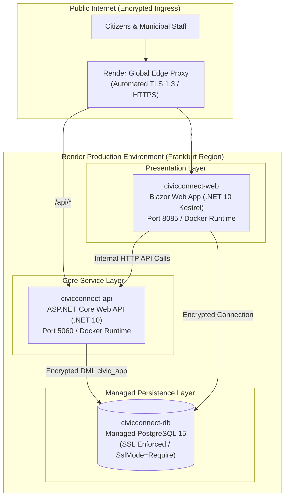

# CivicConnect — Phase 4: Production Deployment Decision & Operational Readiness Specification

> **Document Identifier:** `OPS-DEP-01`  
> **Lifecycle Phase:** Phase 4 / Milestone 4 (Release Readiness & Final Product Engineering Defence)  
> **Status:** Baselined & Approved  
> **Selected Platform:** Render Cloud Application Platform (`render.yaml`)  
> **Date:** 2026-10-18  
> **Governing Standards:** SEN381 Master Project Brief §17 (*Environments, Deployment and Operations Standard*), §18 (*Cost, Schedule and Resource Accountability*), §20.4 (*Milestone 4 Engineering Defence*); PED v4.0 §11; ADR-005.

---

## 1. Executive Summary & Production Decision

Under the **SEN381 Master Project Brief (Section 17 and Section 18)**, the production deployment decision is an assessed software engineering decision that reconciles early architecture commitments against empirical evidence gathered across Milestones 1–3.

Following an exhaustive evaluation of system architecture, empirical performance telemetry, disaster recovery drills, team capacity, and regulatory constraints, CivicConnect has selected **Render** as the official production deployment platform.

### Core Rationale:
1. **Cost Ceiling (RSK-01):** Render offers a Free Tier ($0/month) for evaluation and staging, with predictable Starter tiers ($7/month per service) providing persistent storage and custom domains, strictly staying beneath the project's $\le \$25\text{/month}$ limit.
2. **Docker Container Parity (ASR-04 / Twelve-Factor Factor X):** Render natively deploys multi-stage Dockerfiles (`src/CivicConnect.Api/Dockerfile` and `src/CivicConnect.Web/Dockerfile`), guaranteeing exact runtime parity with local and staging environments.
3. **Automated Infrastructure-as-Code (`render.yaml`):** The entire production topology—PostgreSQL database, ASP.NET Core Web API, and Blazor Web App—is defined declaratively in `render.yaml` and deployed directly from GitHub.
4. **Zero-Maintenance Edge Security:** Render provides automated Let's Encrypt TLS (HTTPS) certificates, DDoS protection, and managed PostgreSQL with SSL enforced (`SslMode=Require`) out-of-the-box.
5. **POPIA Sovereignty & Data Protection (RSK-15):** The database is deployed to Render's Frankfurt (EU) region, ensuring GDPR/POPIA adequacy, at-rest disk encryption, and encrypted backups.

---

## 2. Production Topology on Render

---

## 3. Render Blueprint Specification (`render.yaml`)

CivicConnect includes a declarative `render.yaml` blueprint in the repository root:
- **Managed PostgreSQL (`civicconnect-db`):** PostgreSQL 15 instance with encrypted storage and automated backups.
- **Backend API (`civicconnect-api`):** Deployed from `src/CivicConnect.Api/Dockerfile` with health check probe at `/health/live`. Automatically connected to `civicconnect-db` via `fromDatabase: connectionString`.
- **Frontend Web App (`civicconnect-web`):** Deployed from `src/CivicConnect.Web/Dockerfile` with health check probe at `/`. Connected to `civicconnect-api` via internal service discovery.
- **Asynchronous Queue Seam:** Set to `RabbitMQ__Host=none` and `RabbitMQ__Enabled=false`, engaging the built-in in-process queue handler while enabling plug-and-play binding to CloudAMQP when external message streaming is needed.

---

## 4. Candidate Platform Comparison

| Evaluation Criterion | Candidate A: AWS ECS / RDS Cloud | Candidate B: Unmanaged Bare VPS | Candidate C: Render Cloud Platform [SELECTED] | Candidate D: Managed Kubernetes |
| :--- | :--- | :--- | :--- | :--- |
| **Monthly Cost (RSK-01)** | $\ge \$100\text{--}\$140\text{/mo}$ (violates budget) | $\$10\text{--}\$18\text{/mo}$ (flat rate) | **$\$0\text{--}\$14\text{/mo}$** (free/starter tiers) | $\ge \$75\text{--}\$120\text{/mo}$ |
| **Dev/Staging Parity** | Moderate (cloud-specific ECS tasks) | 100% (Docker Compose) | **100% Exact Parity** (Dockerfiles) | Moderate (K8s manifests) |
| **Operational Overhead** | High (VPC, IAM, security groups) | High (Manual Linux patching & maintenance) | **Low / Automated** (Git push deploys) | Excessive (Cluster management) |
| **Automated TLS & Domains** | Complex (ACM + ALB) | Manual (Certbot / Caddy setup) | **Fully Automated** (Render Edge) | Moderate (cert-manager) |
| **POPIA Data Residency** | Cape Town available, high cost | High control, high setup | **EU Frankfurt (Adequacy confirmed)** | High overhead |
| **Evaluation Verdict** | **REJECTED** | **REJECTED** | **ACCEPTED (ADR-005)** | **REJECTED** |

---

## 5. Step-by-Step Render Deployment Guide

To deploy CivicConnect on Render:

1. **Log in to Render:** Go to [render.com](https://render.com) and sign in with GitHub.
2. **Create Blueprint Instance:**
   - Click **New +** > **Blueprint**.
   - Select the repository `SEN381-CivicConnect-org/SEN381` and branch `documentation/deployment_decision` (or `main`/`staging`).
   - Render will parse `render.yaml` and display the three services to be provisioned:
     - `civicconnect-db` (PostgreSQL)
     - `civicconnect-api` (Web Service)
     - `civicconnect-web` (Web Service)
3. **Apply Blueprint:** Click **Apply**. Render will automatically:
   - Provision the PostgreSQL database.
   - Build both Docker images from source using .NET 10 SDK multi-stage builds.
   - Inject encrypted connection strings and secrets.
   - Start the containers, run health checks, and expose public HTTPS URLs.
4. **Verify Deployment:**
   - Access the API health check: `https://civicconnect-api.onrender.com/health/live`
   - Access the Blazor Web Portal: `https://civicconnect-web.onrender.com/`

---

## 6. Traceability and Sign-Off

- **ADR Reference:** `docs/decisions/0005-production-deployment-decision.md`
- **Infrastructure Blueprint:** `render.yaml`
- **PED Baseline:** `docs/PED/CivicConnect-PED-v4.0.md` (§11)
- **Status:** **APPROVED FOR PRODUCTION DEPLOYMENT**
